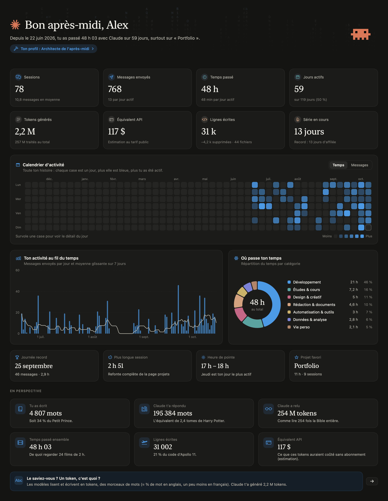
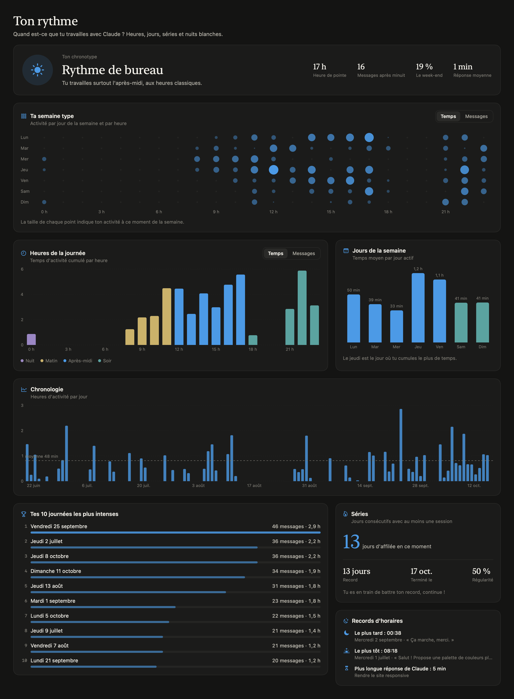
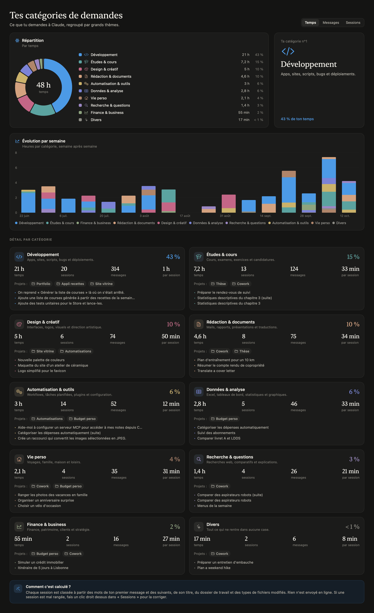
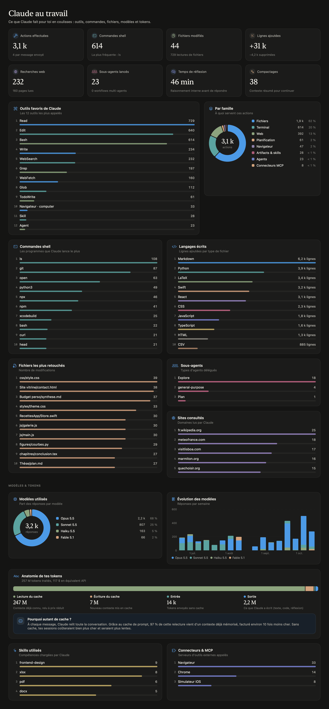
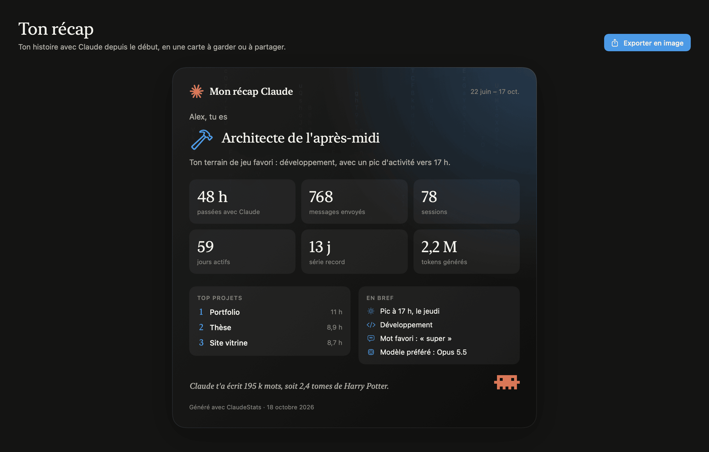

# ClaudeStats

**Tes statistiques Claude, sur ton Mac.** ClaudeStats est une app macOS native (SwiftUI) qui lit les sessions Claude stockées sur ton ordinateur et les transforme en tableaux de bord ludiques et pédagogiques : où passe ton temps, à quelles heures tu travailles, ce que tu demandes, ce que Claude fait pour toi en coulisses.

Tout est lu et calculé **en local** : aucune donnée ne quitte ton Mac.

<p align="center">
  
</p>

<table>
  <tr>
    <th>Rythme</th>
    <th>Catégories</th>
  </tr>
  <tr>
    <td valign="top"></td>
    <td valign="top"></td>
  </tr>
  <tr>
    <th>Claude au travail</th>
    <th>Ton récap</th>
  </tr>
  <tr>
    <td valign="top"></td>
    <td valign="top"></td>
  </tr>
</table>

<sub>Captures réalisées avec des données fictives (mode `--demo`), pas avec de vraies sessions.</sub>

> *English: a native macOS app that turns your local Claude Code / Cowork sessions into fun, private usage dashboards. The interface is in French.*

> Projet personnel et non officiel, sans lien avec Anthropic. « Claude » est une marque d'Anthropic.

## Ce que tu y trouves

| Page | Contenu |
| --- | --- |
| **Vue d'ensemble** | Sessions, messages, temps d'activité, jours actifs, tokens, équivalent API, lignes écrites, séries, calendrier d'activité, records, équivalences (« X tomes de Harry Potter ») |
| **Rythme** | Semaine type jour × heure, heures et jours favoris, chronotype, séries, records d'horaires |
| **Projets** | Temps, sessions, messages et tokens par dossier de travail, avec évolution hebdomadaire |
| **Catégories** | Développement, études, finance, rédaction, design, données, recherche, automatisation, vie perso… |
| **Sessions** | Liste triable et filtrable, détail par session (outils, modèles, tes messages) |
| **Claude au travail** | Outils, commandes shell, langages écrits, fichiers retouchés, sous-agents, sites consultés, modèles, anatomie des tokens et du cache |
| **Ton style** | Nuage de mots, langues, longueur des messages, politesse-o-mètre, commandes slash |
| **Limites d'usage** | Fenêtre de 5 h et quota hebdomadaire jour par jour |
| **Badges** | 24 défis à débloquer |
| **Ton récap** | Carte façon « Wrapped », exportable en PNG |
| **Comprendre** | Tokens, contexte, cache, compactage, sous-agents… expliqués avec tes propres chiffres |

Filtres par période (7 j, 30 j, 90 j, 1 an, tout), par source et par projet. Thèmes clair et sombre. Une icône dans la barre des menus résume ta journée.

## Installation

### Télécharger l'app

1. Récupère `ClaudeStats.zip` dans les [Releases](../../releases) et décompresse-le.
2. Glisse `ClaudeStats.app` dans ton dossier Applications.
3. L'app n'est pas notarisée par Apple : au premier lancement, fais **clic droit › Ouvrir**, puis confirme. Si macOS bloque encore :

```bash
xattr -dr com.apple.quarantine /Applications/ClaudeStats.app
```

### Compiler depuis les sources

Prérequis : macOS 15 ou plus récent, Xcode 16 ou plus récent.

```bash
git clone https://github.com/Olima34/ClaudeStats.git
cd ClaudeStats
./scripts/build_app.sh
```

Le script compile en release, génère l'icône, assemble `ClaudeStats.app` et l'installe dans `~/Applications` (`--no-install` la laisse dans `build/`).

## Sources de données

| Source | Emplacement |
| --- | --- |
| Transcripts Claude Code (app desktop, terminal, sous-agents, workflows) | `~/.claude/projects/**/*.jsonl` |
| Sessions Cowork | `~/Library/Application Support/Claude/local-agent-mode-sessions` |
| Titres, archives, tâches planifiées | `~/Library/Application Support/Claude/claude-code-sessions` |
| Historique des limites d'usage | `~/Library/Application Support/Claude/plan-usage-history.json` |
| Prénom, forfait, skills | `~/.claude.json` |
| Chats claude.ai (optionnel) | Export officiel (claude.ai › Réglages › Confidentialité › Exporter), importé via **Données › Importer un export claude.ai…** |

Les conversations du chat claude.ai sont stockées chez Anthropic, pas sur le Mac : sans import, l'app ne montre que Claude Code et Cowork.

Chaque fichier lu est résumé dans un cache (`~/Library/Application Support/ClaudeStats/`) : seuls les fichiers modifiés sont relus. Compte quelques secondes pour plusieurs gigaoctets de transcripts la première fois, puis un à deux secondes.

## Méthode de calcul

- **Temps d'activité** : les messages d'une session sont regroupés en périodes ; une pause de plus de 15 minutes clôt la période.
- **Doublons** : les sessions « forkées » recopient les lignes de leur parente ; tout est dédoublonné par identifiant.
- **Catégories** : mots-clés en français, anglais et espagnol, titre, dossier de travail et types de fichiers modifiés. Un clic droit sur une session permet de corriger sa catégorie.
- **Équivalent API** : estimation de ce qu'auraient coûté les tokens au tarif public, cache compris. Ce n'est pas ce que tu paies avec un abonnement.

## Pour les développeurs

```bash
swift build -c release
.build/release/ClaudeStats --dump            # résumé texte des chiffres calculés
.build/release/ClaudeStats --snapshot out/   # rend chaque page en PNG (--light, --period week, --page overview, --scale 2)
.build/release/ClaudeStats --demo            # lance l'app avec des données fictives, sans lire le disque
```

`--demo` fonctionne aussi avec `--dump` et `--snapshot`. Les données de démonstration (`Analysis/DemoData.swift`) sont générées avec une graine fixe : environ 80 sessions sur quatre mois, datées par rapport au jour courant. Les captures de ce README en sortent :

```bash
for p in overview rhythm categories tools wrapped; do
  .build/release/ClaudeStats --snapshot docs/screenshots --demo --scale 2 --page $p
done
pngquant --quality 80-95 --force --ext .png docs/screenshots/*.png   # optionnel : divise le poids par cinq
```

Le code est organisé en trois couches : `Data/` (lecture rapide des JSONL, cache), `Analysis/` (dédoublonnage, statistiques, catégories, badges) et `UI/` (SwiftUI + Swift Charts).

## Licence

[MIT](LICENSE)
